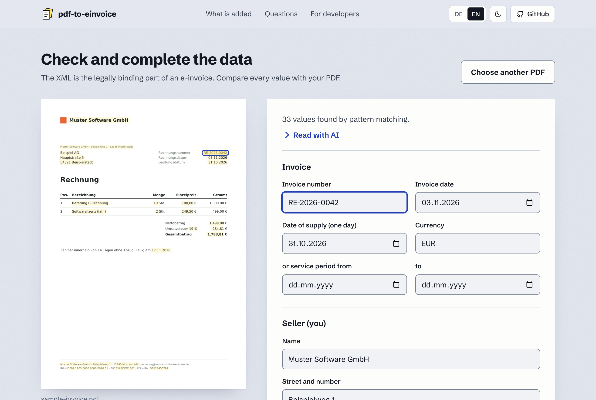

# pdf-to-einvoice

Turn the invoice PDF you already have into an e-invoice (ZUGFeRD / Factur-X, EN 16931) without changing how it
looks. In the browser, on the command line, as a TypeScript library, or as an MCP server for AI assistants.

[](https://github.com/smart-byte/pdf-to-einvoice/actions/workflows/ci.yml)
[](https://www.npmjs.com/package/pdf-to-einvoice)
[](LICENSE)



An e-invoice (German: _E-Rechnung_) is an invoice that software can read. The hybrid kind, ZUGFeRD in Germany and
Factur-X in France, is a PDF that carries the invoice a second time as XML. Most tools make you write your invoices
in their format. This one starts from the PDF you already produce with Word, your invoicing tool or a template:

- **Your layout stays.** The pages are not redrawn. The data is attached as `factur-x.xml` and the file becomes a
  PDF/A-3.
- **It tells you what is missing.** Required fields, sums that do not add up, and values that do not appear on
  your PDF are listed before anything is created.
- **Nothing is uploaded.** The web app has no server; the library and CLI run on your machine.
- **The common kinds of invoice.** Domestic with VAT, several rates, small businesses, reverse charge, intra-community
  supplies, exports, services to non-EU customers, credit notes and corrections.
- **XRechnung for public bodies.** The same data can be written as an [XRechnung](#xrechnung), as plain XML or
  inside the PDF, once it has what XRechnung asks for on top.
- **Checked against the reference.** In CI each of those kinds is created from a sample PDF and validated by an
  independent reference validator: veraPDF for PDF/A-3 plus the official EN 16931 and Factur-X rules, and the
  XRechnung rules for the XRechnung output. What your own PDF brings along is a different matter, see
  [What changes in your PDF](#what-changes-in-your-pdf).

## In the browser

**[Open the web app](https://pdf-to-einvoice.app/)**, or start it locally with `npm run site`. Drop a PDF, check the data that was read from it, download the
e-invoice. Reading works without any AI by pattern matching; optionally a small language model that runs in your
browser (WebGPU) fills in what the patterns did not find. The page is available in English and German.

### Compared with online converters

Many services convert PDF invoices too. The main difference is where your invoice is processed.

|                                         | typical online converter                                                                               | pdf-to-einvoice                                                                       |
| --------------------------------------- | ------------------------------------------------------------------------------------------------------ | ------------------------------------------------------------------------------------- |
| Where is your invoice processed?        | On the provider's servers: the file is uploaded.                                                       | On your device, in the browser. Nothing is uploaded.                                  |
| Who reads the data?                     | Depending on the provider, an AI service in the cloud, also outside the EU, or you type everything in. | Rules on your device; on request also a language model that runs in your browser too. |
| Where does each value come from?        | You get a form to correct.                                                                             | Each value is marked on the PDF, and the XML is compared with the PDF.                |
| Account, ads, tracking                  | Depending on the provider, sign-up, ads or a subscription.                                             | No sign-up, no ads, no cookies.                                                       |
| Source code                             | Mostly closed.                                                                                         | Open (MIT licence): anyone can check what the page does.                              |
| For software and AI assistants          | Mostly an API that invoices are sent to.                                                               | Library, command line tool and MCP server, all on your own machine.                   |
| Formats                                 | ZUGFeRD, often XRechnung and more.                                                                     | ZUGFeRD / Factur-X and XRechnung, following EN 16931.                                 |
| Checking against the official rule sets | Some offer their own validator.                                                                        | Its own plausibility check; not a complete check against the official rule sets.      |

## As a library

```bash
npm install pdf-to-einvoice
```

```ts
import { readFile, writeFile } from 'node:fs/promises';
import { createEInvoice } from 'pdf-to-einvoice';

const { pdf, xml, findings } = await createEInvoice({
  pdf: await readFile('invoice.pdf'),
  invoice: {
    number: 'RE-2026-0042',
    issueDate: '2026-11-03',
    deliveryDate: '2026-10-31',
    dueDate: '2026-11-17',
    iban: 'DE02120300000000202051',
    seller: { name: 'Muster Software GmbH', street: 'Beispielweg 1', postalCode: '12345', city: 'Musterstadt', country: 'DE', vatId: 'DE123456789' },
    buyer: { name: 'Beispiel AG', street: 'Hauptstraße 5', postalCode: '54321', city: 'Beispielstadt', country: 'DE' },
    lines: [{ name: 'Consulting', quantity: 10, unit: 'HUR', unitPrice: 100, vatRate: 19 }],
  },
});

await writeFile('invoice.einvoice.pdf', pdf);
```

It works the same in a browser: `pdf` is a `Uint8Array` in and out. A bundler needs two things set up, as
[`site/vite.config.ts`](site/vite.config.ts) and [`site/main.ts`](site/main.ts) do: an alias that points
`@e-invoice-eu/core` to its browser bundle, and the worker of pdf.js.

| function                                     | what it does                                                                                                       |
| -------------------------------------------- | ------------------------------------------------------------------------------------------------------------------ |
| `createEInvoice({ pdf, invoice, profile? })` | checks the data, then returns `{ pdf, xml, findings, totals }`; throws `InvoiceError` if data is wrong             |
| `createXRechnung({ invoice, syntax? })`      | the data as an [XRechnung](#xrechnung): returns `{ xml, findings, totals }`, no PDF; throws `InvoiceError` as well |
| `check(invoice, { pdfText?, rules? })`       | returns `{ findings, totals, invoice? }` without creating anything; never throws on incomplete data                |
| `extractText(pdf)`                           | the text of a PDF, row by row                                                                                      |
| `extractLayout(pdf)`                         | the text plus its geometry: `blocks` (text that stands together), `pieces` with their position, `pages`            |
| `guessFromText(text, { blocks })`            | reads an invoice without a model: totals that add up, items that add up to them, seller and buyer, labelled values |
| `keepWhatThePdfShows(draft, text)`           | drops every value the PDF does not show: a guard for data read by a small language model                           |
| `languageOf(text)`                           | `'de'` or `'en'`: the language an invoice is written in                                                            |
| `validateEInvoice(pdf)`                      | looks at an existing e-invoice: profile, embedded data, and whether the XML matches the visible page               |
| `readEmbeddedXml(pdf)`                       | the XML of an existing e-invoice, or `null`                                                                        |
| `calculate(invoice)`                         | the totals, following the EN 16931 rounding rules                                                                  |
| `invoiceJsonSchema`                          | JSON Schema of the invoice data, for forms, validation and language models                                         |

A finding is `{ path, severity, code, message }`. An `error` blocks the e-invoice; a `warning` asks for a second
look.

## On the command line

```bash
npx pdf-to-einvoice read invoice.pdf --json      # text, guessed values and facts about the PDF
npx pdf-to-einvoice schema                       # the JSON Schema of the invoice data
npx pdf-to-einvoice check invoice.json --pdf invoice.pdf
npx pdf-to-einvoice create invoice.pdf invoice.json   # writes invoice.einvoice.pdf
npx pdf-to-einvoice validate invoice.einvoice.pdf
npx pdf-to-einvoice xml invoice.einvoice.pdf     # prints the embedded XML
npx pdf-to-einvoice xrechnung invoice.json -o invoice.xml   # the data as an XRechnung, see below
```

`create` and `xrechnung` never overwrite a file unless you pass `--force`, and never write over their input.

## Many invoices at once

An invoicing program that issues many invoices already has what this tool needs: the PDF it renders and the data it
renders it from. Pass that data on instead of reading it back from the PDF. Reading by pattern matching or with a
language model is a first draft for a person to check, not something to run unattended over a batch.

```ts
import { readFile, writeFile } from 'node:fs/promises';
import { createEInvoice, InvoiceError } from 'pdf-to-einvoice';

// From your invoicing system: the path of each rendered PDF and the data it was rendered from.
for (const { pdfPath, invoice } of invoicesToConvert) {
  try {
    const { pdf, findings } = await createEInvoice({ pdf: await readFile(pdfPath), invoice });
    await writeFile(pdfPath.replace(/\.pdf$/i, '.einvoice.pdf'), pdf);
    for (const finding of findings) console.warn(pdfPath, finding.path, finding.message); // warnings only
  } catch (error) {
    if (!(error instanceof InvoiceError)) throw error;
    // The data has errors: nothing was written. Fix them where the data comes from and run this invoice again.
    console.error(
      pdfPath,
      error.findings.map((finding) => `${finding.path}: ${finding.message}`),
    );
  }
}
```

The same works with `createXRechnung({ invoice })` for invoices to public bodies. On the command line, with a data file
next to each PDF (`RE-1.pdf` and `RE-1.json`):

```bash
for pdf in invoices/*.pdf; do
  npx pdf-to-einvoice create "$pdf" "${pdf%.pdf}.json" || echo "not created: $pdf"
done
```

Everything runs where you run it, on a laptop as on your own server; no invoice is sent anywhere. The MCP server, in
contrast, is made for one invoice at a time, with the user confirming the data.

## For AI assistants

The MCP server lets an AI assistant do the whole job on your machine: read the PDF, fill in the data,
show you what is missing, and create the file after you confirm.

```json
{
  "mcpServers": {
    "pdf-to-einvoice": { "command": "npx", "args": ["-y", "pdf-to-einvoice", "mcp"] }
  }
}
```

Tools: `read_invoice_pdf`, `check_invoice`, `create_einvoice`, `create_xrechnung`, `validate_einvoice`,
`read_einvoice_xml`. For agents that work with a shell instead,
[skills/pdf-to-einvoice/SKILL.md](skills/pdf-to-einvoice/SKILL.md) describes the same workflow with the CLI. A
summary for language models is in [llms.txt](site/public/llms.txt).

The server needs no API key and calls no model itself: the assistant you already use reads the invoice.

## The invoice data

Small and flat on purpose. Required: `number`, `issueDate`, `seller` and `buyer` with `name` and `country`, a tax
identifier of the seller (`vatId` or `taxNumber`), at least one line, and a `dueDate` or `paymentTerms` when money is
owed. Defaults: `typeCode` 380 (invoice), `currency` EUR, `unit` C62 (piece), `vatCategory` S.

| VAT category | meaning                | typical case                                           |
| ------------ | ---------------------- | ------------------------------------------------------ |
| `S`          | standard rate          | domestic sale with VAT (any rate above 0)              |
| `Z`          | zero rated             | goods taxed at 0 %                                     |
| `E`          | exempt                 | small business (§ 19 UStG), exempt services            |
| `AE`         | reverse charge         | service for a business in another EU country           |
| `K`          | intra-community supply | goods delivered to a business in another EU country    |
| `G`          | export                 | goods delivered outside the EU                         |
| `O`          | not subject to VAT     | service for a business outside the EU, e.g. in the USA |

Every category except `S` and `Z` needs `vatExemptionReason`: the sentence on your invoice that says why no VAT is
charged. `totals` are the sums printed on the PDF; if they contradict the calculation, that is an error, because the
XML must not say something else than the page. The full list of fields is in
[`src/model.ts`](src/model.ts) and in `npx pdf-to-einvoice schema`.

## XRechnung

XRechnung is the German version of EN 16931 that public bodies ask for. The same invoice data can be written as one,
in two ways:

- **As plain XML**, without a PDF, in UBL (default) or CII: `createXRechnung({ invoice, syntax? })`, the command
  `xrechnung <data.json> [--syntax ubl|cii] [-o out.xml]` (to standard output without `-o`), the MCP tool
  `create_xrechnung`.
- **Inside the hybrid PDF**, in place of the EN 16931 profile: `createEInvoice({ pdf, invoice, profile: 'xrechnung' })`,
  `create ... --profile xrechnung`, the argument `profile` of `create_einvoice`. The attachment is then named
  `xrechnung.xml`.

```ts
import { createXRechnung } from 'pdf-to-einvoice';

const { xml, findings } = await createXRechnung({ invoice, syntax: 'ubl' }); // or 'cii'
```

The XML declares XRechnung 3.0 (`urn:cen.eu:en16931:2017#compliant#urn:xeinkauf.de:kosit:xrechnung_3.0`); the rules
are taken from its specification in version 3.0.2. XRechnung asks for more than EN 16931 does.
`check(invoice, { rules: 'xrechnung' })`, `check --rules xrechnung` and the argument `rules` of `check_invoice` report
what is missing, and both ways of creating run that check first and refuse the data while an error is open:

| code                                                                           | what XRechnung asks for                                                                              |
| ------------------------------------------------------------------------------ | ---------------------------------------------------------------------------------------------------- |
| `xrechnung-buyer-reference`                                                    | `buyerReference`: for a German public body its Leitweg-ID, which the buyer names                     |
| `xrechnung-seller-contact`, `xrechnung-seller-phone`, `xrechnung-seller-email` | a contact at the seller: `seller.contactName`, `seller.phone`, `seller.email`                        |
| `xrechnung-buyer-email`                                                        | `buyer.email`, which is written as the electronic address of the buyer                               |
| `xrechnung-address`                                                            | `city` and `postalCode` of seller and buyer                                                          |
| `xrechnung-line-net`                                                           | a `netAmount` of a line that is quantity x unit price, at most 0.02 apart                            |
| `xrechnung-payment-terms`                                                      | a line of `paymentTerms` that starts with `#` to be a cash discount: `#SKONTO#TAGE=14#PROZENT=2.00#` |
| `xrechnung-delivery-address`                                                   | the place of delivery of an intra-community supply (`K`); the data has no field for it, see below    |

Three more findings are warnings, because XRechnung only recommends what they are about: `xrechnung-type-code` (a
prepayment invoice, type 386, is not among its invoice types), `xrechnung-phone` and `xrechnung-email` (a phone
number with three digits at least, an e-mail address of the usual form).

Some things the tool writes on its own, because XRechnung wants them in the XML: payment instructions in every
invoice (without an `iban` they read "instrument not defined", code 1), the business process
`urn:fdc:peppol.eu:2017:poacc:billing:01:1.0`, which the specification names as the default, and the e-mail
addresses of seller and buyer as their electronic addresses (scheme `EM`). In UBL a credit note (type 381) is
written as a `CreditNote` document.

Limits of the XRechnung output:

- An intra-community supply (`K`) is refused. XRechnung wants the city and postal code of its place of delivery, and
  the invoice data has no delivery address yet.
- The electronic address of seller and buyer is always an e-mail address. A Leitweg-ID or a Peppol participant ID
  cannot be given there.
- The extension of XRechnung (sub-lines of an invoice line, payments by a third party) is not written.
- The file is not sent anywhere. How a public body takes invoices in (a portal upload, e-mail, Peppol) is for it to
  say.
- `validateEInvoice` reads the XML inside a PDF. It does not read a plain XML file, and no UBL.

## What changes in your PDF

Only what the standard asks for: the XML attachment, XMP metadata that declares PDF/A-3 and Factur-X, an sRGB
output intent and a document ID. Images that ask viewers to smooth them (`/Interpolate true`) have that flag switched
off, because PDF/A forbids it. The page content is not touched.

One defect is detected and reported: fonts that are not embedded. The XML is still valid then, but the file is not a
strict PDF/A-3; export the PDF with embedded fonts (or as PDF/A) and run it again. Other things PDF/A forbids in
your original are neither found nor repaired. If the software of a recipient rejects the file, check it with a PDF/A
validator.

## Limits

- **Only the issuer can issue an e-invoice.** A PDF you _received_ does not become a valid e-invoice because you
  converted it. If you sent a plain PDF where an e-invoice was required, issue a corrected invoice (type 384) that
  refers to the original.
- **Reading is still being broadened.** Pattern matching reads the layouts it knows well and less of others; what it
  cannot place is left empty and shown as missing. Reading invoices of every kind is work in progress.
- **The XML is the binding part.** The tool checks arithmetic and compares the data with the text of the PDF, but
  it cannot know what you meant. Review the data before you create the file.
- **Profiles and syntax:** the hybrid PDF carries CII in the Factur-X / ZUGFeRD profile EN 16931 or XRECHNUNG. Plain
  XML is written as [XRechnung](#xrechnung) only, in UBL or CII; the profiles BASIC and EXTENDED and plain EN 16931
  XML without XRechnung are not built.
- **Not modelled yet:** discounts and charges on the whole invoice (use a line with a negative quantity), VAT in a
  second currency, several payment accounts, attachments.
- **`validateEInvoice` is a plausibility check,** not a replacement for a full validator.
- **No encryption or password protection:** PDF/A forbids it, so a protected file would no longer be a valid
  e-invoice.
- **Country rules:** a hybrid PDF is how e-invoices are exchanged in Germany. Italy, Poland, Belgium and France
  route invoices through national platforms or networks; a file alone is not enough there.
- This is a tool, not tax or legal advice.

## Built on

[`@e-invoice-eu/core`](https://github.com/gflohr/e-invoice-eu) writes the XML and embeds it,
[`@cantoo/pdf-lib`](https://github.com/cantoo-scribe/pdf-lib) reads and repairs PDFs,
[pdf.js](https://mozilla.github.io/pdf.js/) extracts text, [WebLLM](https://webllm.mlc.ai/) runs models in the
browser, and the [MCP TypeScript SDK](https://github.com/modelcontextprotocol/typescript-sdk) speaks to assistants.
This project adds the simple data model, the checks, the comparison with the PDF and the front ends. Licences are
listed in [THIRD_PARTY_NOTICES.md](THIRD_PARTY_NOTICES.md).

## Develop

```bash
npm install
npm test                 # unit tests
npm run type-check && npm run lint && npm run format:check
npm run site             # the web app on http://localhost:4350
```

`npm run test:reference` runs the reference validation on generated invoices; it needs Java and the validator, see
[CONTRIBUTING.md](CONTRIBUTING.md).

`npm run eval:reader -- <folder>` measures how much the reader gets right on e-invoices that carry their own answer
(their XML), with the rules alone or together with a language model; CONTRIBUTING.md says where to get such files.

## Licence

MIT, see [LICENSE](LICENSE). The software implements the semantic data model of the European standard
EN 16931-1:2017; the standard itself is the property of CEN and is not part of this repository.

ZUGFeRD, Factur-X and XRechnung are names of their respective owners. This project is independent: it is not
affiliated with the organisations behind these standards, and it is neither endorsed nor certified by them.
