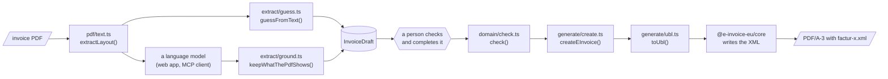
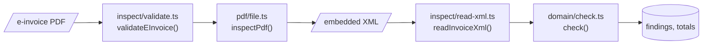

# Architecture

How the code is laid out, how an invoice moves through it, and the conventions that hold it together. For what lies
where in one line each, see the table in [AGENTS.md](../AGENTS.md); for how to contribute,
[CONTRIBUTING.md](../CONTRIBUTING.md).

## Two ways through the code

The tool does two things: it turns an invoice PDF into an e-invoice, and it checks an e-invoice that exists. Every
front end (library, command line, MCP server, web app) runs the same code in `src/` for both.

### From a PDF to an e-invoice

1. **Read the page.** `extractLayout()` returns the text of the PDF row by row, and its blocks: the columns as the page
   sets them. Nothing about invoices is known at this point. A row is one line of text with three spaces between its
   columns; `util/rows.ts` writes it for `pdf/` and takes it apart for the reader, since neither may use the other.
2. **Read the invoice from it**, in one of two ways. `guessFromText()` finds values by pattern, without a model: three
   amounts with net + VAT = gross, rows that add up to them, a party under its label. A language model reads more, but
   may invent; `keepWhatThePdfShows()` drops every value it returned that the text of the page does not show. Either
   way the result is an `InvoiceDraft`: incomplete, and not to be trusted yet.
3. **A person looks at it.** The web app shows each value beside the place it was read from; the MCP server tells the
   assistant to ask the user. Nothing is created from data nobody has seen.
4. **Check it.** `check()` applies the rules of EN 16931, of German VAT law and, on request, of XRechnung, calculates
   every total in whole cents (`domain/calculate.ts`) and compares the data with the text of the PDF. It never throws:
   it returns findings, and the cleaned invoice only when there is no error.
5. **Write it.** `createEInvoice()` checks again, maps the invoice to UBL (`toUbl()`) and has
   [@e-invoice-eu/core](https://github.com/gflohr/e-invoice-eu) write the XML and attach it to the PDF, which becomes a
   PDF/A-3; its pages are not changed. `createXRechnung()` writes the XML alone.

### Checking an e-invoice that exists

`validateEInvoice()` takes the XML out of the PDF, reads it back into an `InvoiceDraft` and runs the same `check()`.
What the data cannot hold, such as a discount whose amount contradicts its own base, `readInvoiceXml()` names and
`validateEInvoice()` reports. This
is a plausibility check, not a validation against the Schematron rules; `npm run test:reference` does that for the files
this tool writes.

## Layers

`src/` has one folder per layer. A layer imports only itself and the layers named in its row, and
[test/architecture.test.ts](../test/architecture.test.ts) fails when that is broken, or when two files import each
other,
however indirectly.

| layer           | holds                                                                                       | may import        |
| --------------- | ------------------------------------------------------------------------------------------- | ----------------- |
| `src/adapters/` | command line, MCP server, and the work with files on disk both share                        | all other layers  |
| `src/inspect/`  | reading and checking an existing e-invoice                                                  | domain, pdf, util |
| `src/generate/` | the UBL document and the e-invoice file                                                     | domain, pdf, util |
| `src/extract/`  | invoice data from the text of a PDF                                                         | domain, util      |
| `src/pdf/`      | the text, the layout and the structure of a PDF; knows nothing of invoices                  | util              |
| `src/domain/`   | the data model, the rules, the totals, the findings and their texts; knows nothing of files | util              |
| `src/util/`     | small helpers without a subject of their own                                                | nothing           |

`src/index.ts` is the public API of the package: what it exports is all a user of the library can import
(`package.json` exports no other entry; the command line is its `bin`). The adapters are not part of it, since they
need Node.

The web app in `site/` is a front end like the adapters. Its scripts stand in three parts with rules of their own:
`site/app/` is the start page, with one module per section of the page and `main.ts` loading them; `site/legal/` is the
script of the legal pages; `site/shared/` is what both use. A part imports `shared/` and `src/`, never another part and
never `src/adapters/`.

`test/` has the folders of `src/` and `test/site/` for the web app. Tests go through the functions a layer exports,
not through its inner parts, so a layer can be rebuilt inside without changing its tests.

## Conventions

**A module is the unit of encapsulation.** TypeScript has no package-private: what a file exports, any file may import,
and what it does not export, no other file can reach. Where Java has a class with private methods, this code has a file
with exported and unexported functions. Variables that hold state, as in the web app, are not exported; other modules
change them through a function of their owner.

**Imports name the `.js` file.** `import { check } from './check.js'` refers to `check.ts`. TypeScript does not rewrite
paths when it compiles, and Node needs the name of the file that exists at run time.

**Data from outside is `Unchecked` until `check()` has seen it.** A draft from a PDF, a model, a JSON file or an MCP
call may hold anything in any field. `Unchecked<T>` names the fields of `T` and holds every value as `unknown`, so a
misspelt field does not compile and code that reads a value guards it first (`isNumber()`, `isVatCategory()` and the
like); after `check()` it is an `Invoice` whose types hold.

**Money is whole cents.** `domain/money.ts` takes amounts as integer cents in `BigInt` and rounds half away from
zero; `domain/calculate.ts` sums the totals with it, `domain/adjustments.ts` the discounts and charges on the whole
invoice. Other code formats amounts and compares them in cents with `cents()`, it does not calculate with them.

**A finding has a code and a text from the catalog.** `error(path, key, values)` and `warning(...)` in
`domain/finding.ts` take both from `domain/messages.ts`. The code is stable: the web app shows a German text for it from
`site/shared/i18n.ts`, and other front ends may do the same.

**A reader does not guess.** `guessFromText()` believes a value for what it fits to, not for where it stands, and
leaves out what does not fit. A missing value is filled in by a person; a wrong one may go unnoticed. A change to the
reader comes with the table of `npm run eval:reader` before and after.

## Where to start reading

- `src/domain/model.ts`: the `Invoice` with the business terms of EN 16931, and its JSON Schema.
- `src/domain/check.ts`, `check()`: the rules, one function per part of the invoice.
- `src/generate/create.ts`, `createEInvoice()`: how a file is written, from checking to the PDF/A-3.
- `src/extract/guess.ts`, `guessFromText()`: how values are read from a page, part by part in `src/extract/guess/`.
- `site/app/main.ts`: how the web app is put together.
